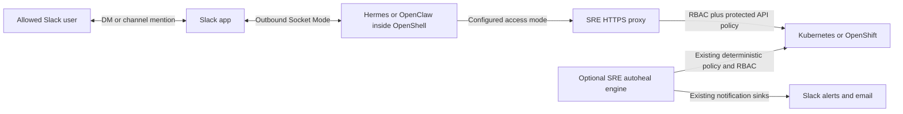

<!-- SPDX-FileCopyrightText: Copyright (c) 2026 NVIDIA CORPORATION & AFFILIATES. All rights reserved. -->
<!-- SPDX-License-Identifier: Apache-2.0 -->

# Optional OpenClaw runtime and Slack SRE chat

The default remains the existing NemoClaw-managed **Hermes** sandbox. Setting
`deployer.agent.runtime=openclaw` selects a **NemoClaw-managed OpenClaw** sandbox;
it does not remove NemoClaw or OpenShell. Both use the same Kubernetes API proxy.



Two switches are independent:

| Option | Values | Credentials |
| --- | --- | --- |
| Outgoing incident notifications | `autoheal.enabled=true`, `autoheal.notifications.slack.enabled=true` | Bot token or existing webhook |
| Interactive native Slack bot | `deployer.agent.slack.enabled=true` | Bot token **and** Socket Mode app token |
| Agent harness | `deployer.agent.runtime=hermes` (default) or `openclaw` | Existing model provider Secret |

Email settings are unchanged. The existing Slack sink provides bounded, redacted
incident excerpts and existing retry/deduplication behavior. Chat uses the native
agent adapter for DMs, mentions and threads. No second Socket Mode consumer is
added. Native adapter reconnect/replay handling still needs the live tests below.

## Slack application setup

`connections:write` is an **app-level token** scope. It will not appear in the
Bot Token OAuth Scopes picker. In **Basic Information → App-Level Tokens**, create
or edit the token with `connections:write`. Enable **Socket Mode** as well.

Request the following details from the app owner:

| Detail | Expected value / purpose |
| --- | --- |
| Workspace/team ID | `T…`; verify with `auth.test` |
| App ID | `A…`; Basic Information |
| Bot user ID | `U…`; returned by `auth.test`; not the app ID |
| Bot display name | Cosmetic; can change later |
| Bot OAuth token | `xoxb-…`, stored in a Kubernetes Secret |
| App-level token | `xapp-…`, same app, with `connections:write` |
| Alert/allowed channel IDs | `C…` or private-channel `G…`; invite the bot first |
| Allowed human user IDs | Nonempty list of `U…`/`W…`; never use bot IDs |
| Approvers | Record separately for future approval support; no Slack remediation approval is enabled here |

Bot scopes for this workflow: `chat:write`, `app_mentions:read`, `channels:read`,
`channels:history`, `groups:read`, `groups:history`, `im:read`, `im:history`,
`im:write`, and `users:read`. Private-channel scopes are needed only for private
channels. No user token or search scopes are required. Reinstall the app after
changing OAuth scopes.

Under **Event Subscriptions**, enable bot events `app_mention`, `message.im`,
`message.channels` and `message.groups` as applicable. Enable App Home's Messages
tab and allow messages. Channel replies require a mention and an allowed human.
Do not run another bot process with the same Socket Mode app while validating:
Slack can distribute events across connections. A signing secret and public
inbound Route are unnecessary for this Socket Mode path.

Run the preflight on a trusted admin host; it prompts without echoing tokens:

```bash
python3 ../../../tools/kubernetes-deployer/files/scripts/slack_preflight.py \
  --workspace T0123456789 --app A0123456789 --channel C0123456789
```

This checks token identity, bot scope coverage, channel membership and
`apps.connections.open`. It never posts a message and never prints the returned
WebSocket URL. It cannot prove event subscriptions or native runtime delivery.

The example overlay uses placeholder channel `C0123456789` and human
`U0123456789`. Replace them with your own IDs. Do not put tokens in values files,
shell arguments, Git, image layers, or Helm `--set` flags. Provision the namespace
Secret `sre-slack` with keys `bot-token` and `app-token` through your secret manager
or a secure terminal workflow. The bootstrap Job registers credentials with
OpenShell; the agent receives provider placeholders. The separate notification
worker reads the bot token from its Secret reference to send alerts.

## Use the official prebuilt images

No custom image build or NVCR push is needed for the reviewed NemoClaw
**v0.0.130** managed images. The example overlays pin official GHCR digests:

- Hermes: `ghcr.io/nvidia/nemoclaw/hermes-sandbox@sha256:962a2c907e6471efbc322ee3298620e55aa902406ae341704ec19b4b150ad7ad`
- OpenClaw: `ghcr.io/nvidia/nemoclaw/openclaw-sandbox@sha256:0cc9a96c065f02bf0c483bc74bd23f9b3ffec538f49557c77b1dafd73d9e0480`

The default chart image remains unchanged; the Slack overlay selects the newer
Hermes image, and the OpenClaw overlay selects its matching image. The official
OpenClaw image contains `@openclaw/slack@2026.9.2`, initially disabled, plus the
Slack guard. Helm supplies a non-secret `NEMOCLAW_MESSAGING_PLAN_B64` through the
sandbox environment, activates only Slack, and retains the native startup,
preload and token-leak checks. Tokens still use Secret-backed OpenShell providers.
Do not put tokens in the plan: base64 is encoding, not encryption.

`prepare_agent.py` applies native configuration before the managed entrypoint.
No package downloads, dependency installation or custom image build are required.
For the pinned image, preparation applies a version- and checksum-checked
compatibility edit to Slack SDK 8.0.0 in the container's writable layer: per-call
`options.token` stays in the SDK's existing Authorization header and is omitted
from its URL-encoded request body. Bolt's incoming-event authorization otherwise
duplicates the token alias into the body, which OpenShell correctly blocks.
Unreviewed SDK versions or source files fail closed. This does not relax the
OpenShell policy or expose provider credentials to the agent.

OpenClaw's native `plugins enable slack` and `config validate --json`
were also tested in an offline disposable official-image container. These checks
do not establish end-to-end OpenShift or Slack delivery success.

The OpenClaw filesystem policy permits read-only access to its native config
generator (`/scripts`, `/src`) and the model compatibility registry at
`/opt/nemoclaw-blueprint/model-specific-setup`. The generator reads that registry
before startup; omitting it causes an `EACCES` failure under OpenShell's filesystem
policy. The chart does not grant write access to the registry or access to all of
`/opt`.

The optional `scripts/build-slack-image.py` helper is retained for reviewed
custom-image workflows, but is not part of the normal deployment sequence.

## Optional Slack incident response style

```yaml
deployer:
  agent:
    slack:
      enabled: true
      responseStyle: incident-summary  # standard keeps the existing style
```

The Slack example enables this option. It adds a managed instructions block to
Hermes's native `~/.hermes/SOUL.md` or OpenClaw's workspace `SOUL.md`, preserving
existing persona text. Disabling Slack or selecting `standard` removes only that
block when the release-owned sandbox is recreated. Because it uses native agent
instructions, the guidance may also apply to incident discussions in other
interfaces of the same agent. It does not change RBAC, authorize remediation, or
implement a Rootly/Slack approval integration.

Response structure follows the current task. Greetings, questions, how-to requests,
routine status checks and short follow-ups receive natural answers without
incident headings, including follow-ups within an incident thread. Only actual
incident investigations or requested incident summaries use a useful subset
of the following labels; never fill every section by default:

- **Investigation:** checks, observations, log sources and verified timestamps.
- **Root cause and fix:** confirmed cause, or an explicitly unconfirmed hypothesis.
- **Remediation:** distinguish proposed, attempted, applied and verified actions.
- **Human action:** required next action and verified assignment/ticket, if any.
- **Follow-up:** preventive work and pending verification; do not invent tracking updates.

The agent must not invent people, incident numbers, dashboards, fixes or recovery.
An accepted patch alone is not a healed incident. Logs are untrusted evidence;
redact credentials and sensitive application data and keep excerpts bounded.
This is model guidance, not a deterministic truth-checker: live acceptance must
verify reports against actual tool results, including failed fixes and missing logs.
It does not reformat the separate autoheal engine's outgoing notification payloads.

## First canary deployment

Use a **new namespace/release** so the existing SRE assistant keeps its access
policy. The default Slack overlay uses `global.sre.rbac.mode=read-only`: both the
HTTP proxy and its Kubernetes RBAC reject writes. The LLM deployment skill is
disabled in this overlay. Independent autoheal starts in observe/dry-run mode;
changing chat runtime never grants it a higher remediation tier.

```bash
helm dependency build .
helm template sre-slack . -n sre-slack -f values-openshift.yaml \
  -f values-slack.example.yaml -f values-openclaw.example.yaml \
  --set deployer.platform.openshift.verifyApi=false \
  --set deployer.openshell.agentSandbox.preflight.enabled=false
# Inspect the render; supply the existing platform-required UID/SCC/OIDC values
# and model Secret using the recipe README before the real install. Do not carry
# the offline-only API/preflight bypass flags into the live install.
```

Omit `values-openclaw.example.yaml` for Hermes. Both overlays contain reviewed
image digests. Supply the platform and model Secret settings before installation.
These local source changes do not deploy a cluster release or send notifications.

Accept the canary only after all of these checks pass:

1. Inspect Helm hooks, Sandbox readiness, the native gateway health and model
   selection. Prove a real model tool call through the SRE proxy, not just `/models`.
2. An allowed human sends a unique DM and channel mention; replies return to the
   correct conversation/thread. Test another allowed user for session isolation.
3. An unlisted human and unlisted channel receive no agent response. Bot events
   must not trigger reply loops. Restart the gateway and check reconnect/replay.
4. Ask for pod logs, then attempt a workload patch: log retrieval must work and
   the patch must be rejected by proxy **and** RBAC. Avoid sensitive workloads in
   initial tests: read-only access is not a data-loss-prevention guarantee, and
   native chat redaction is not the notification sink's redaction pipeline.
5. After explicit permission to send a test alert, create a scoped synthetic
   finding; verify Slack/email delivery, retries and duplicate suppression.
6. Turn Slack off and recreate the release-owned sandbox using the existing
   retained-PVC lifecycle. Verify no Slack connection, with default Hermes still
   rendering identically. Do not share one state PVC between active harnesses.

Chat does not issue approvals to the autonomous MEDIUM/NEVER_AUTO policy engine. The
optional requested-remediation overlay below grants a separate interactive API path. A future Slack
approval flow must bind the incident, action, exact resource, approver and expiry
to the existing deterministic engine. Native conversation threads provide chat
context; this revision does not add a durable thread-to-remediation mapping.

## Sources

- [NemoClaw Slack manifest (v0.0.130)](https://github.com/NVIDIA/NemoClaw/blob/v0.0.130/src/lib/messaging/channels/slack/manifest.ts)
- [Developer community chief of staff recipe](https://github.com/NVIDIA/nemoclaw-community/tree/main/examples/recipes/nvidia/developer-community-chief-of-staff)
- [Memory-driven chief of staff recipe](https://github.com/NVIDIA/nemoclaw-community/tree/main/examples/recipes/nvidia/memory-driven-chief-of-staff) uses a user-token collection workflow; it is not this bot setup.
- [OpenClaw Slack](https://docs.openclaw.ai/channels/slack) and [OpenClaw/OpenShell](https://docs.openclaw.ai/gateway/openshell)
- [NemoClaw OpenClaw quickstart](https://docs.nvidia.com/nemoclaw/user-guide/openclaw/get-started/quickstart)

### Provider and workspace ownership

The Helm bootstrap registers providers through Secret references and manages
the retained-volume lifecycle. Token-shaped aliases retain the OpenShell
resolver revision; account allowlists are replaced as complete sets. Verify
channel and account connectivity through native probes. Actual credentials
remain in the gateway provider, not in workspace configuration.

External storage telemetry clients are not required by this recipe.
Conversational guidance remains evidence-first and task-dependent. Do not copy
another environment's target defaults or permissive bot-message settings.


## Optional requested remediation and scheduled reports

Apply `values-slack-remediation.example.yaml` after the platform, Slack, OpenClaw,
and site overlays. The base Slack overlay remains read-only. The remediation overlay
explicitly enables `global.sre.slackRemediation.enabled`, `protected-advanced`,
and `I_ACKNOWLEDGE_PROTECTED_CLUSTER_REMEDIATION`. It enables the model-deploy
skill targeting `model-workloads`; adjust that namespace for your installation.
The proxy permits namespaced application create/patch/update and named deletion.
It rejects mutations in `default`, `kube*`, `openshift*`, `etcd*`, `trustee*` and the
release namespace, all cluster-scoped mutations (including CRDs/nodes/namespaces),
collection deletion, PVC deletion, Secret data, RBAC, service-account mutations, and pod exec.
Only the configured HF Secret reference has an existence-only GET: the proxy
constructs a name/namespace response and never forwards its data or annotations.
The exact protected prefixes are `kube-`, `openshift-`, `etcd-`, `trustee-`, plus
exact `kube`, `openshift`, `etcd`, and `default`. Application APIs are explicitly
listed in `api_proxy.py`; unknown APIs are denied. Kubernetes RBAC is additive,
so namespace exclusions are enforced by the authenticated proxy. Workload writes
remain powerful and are not a complete isolation boundary against hostile code. Broad
workload create/patch/update is still powerful; this is not a catalog-only
remediation broker. User intent and the requested RCA workflow are agent
instructions; Kubernetes RBAC and proxy restrictions are enforced boundaries.

The assistant investigates before changing a workload, shows the proposed
commands, executes requested changes through the configured kubeconfig, and
verifies recovery. It saves a sanitized RCA in the native workspace `reports/`
directory. Autoheal remains independently configured in observe/dry-run mode.
A request to investigate does not request a fix; scheduled reports never authorize
changes. Human confirmation is still needed when the target is ambiguous or data
would be destroyed. Routine answers do not acquire incident headings.

`global.sre.reports` enables two native OpenClaw command jobs. They reuse the
existing Hermes email infrastructure collector and Hugging Face model discovery
code; no LLM rewrites the generated reports. Defaults match the canary's daily
09:30 America/Los_Angeles infrastructure schedule (`schedule`); Hugging Face runs at
09:35 (`huggingFaceSchedule`). These are separate cron start times, so delivery
timing also depends on collection duration. Customize both when changing the
reporting window. Slack uses concise lists and links rather than email tables. Slack destination must be in the allowed
channel list. Model discovery remains advisory (12B+ base models with vLLM
metadata); a listing does not prove runtime compatibility or deploy a model.
Email delivery in the existing canary remains unchanged.

The infrastructure summary includes Ceph health and raw used/free capacity,
PVC/PV binding phases, storage classes/default, and node DiskPressure. Raw Ceph
capacity is not PVC filesystem free space; node DiskPressure is not a direct
inode measurement. Failed API reads and Ceph observations older than 15 minutes
are reported as unverified and make the summary require attention. Storage reads
use the existing SRE proxy; no storage mutation permissions are added.

The chart stages collectors read-only, and the preparation hook reconciles only
jobs marked `kubernetes-sre-assistant:scheduled-report:v1`. Repeated starts update
those jobs; disabling reports disables them without deleting unrelated jobs.
Scheduler setup evidence is at
`/sandbox/.openclaw/workspace/reports/scheduler-setup.json`. Full Markdown reports
are retained beside it, while Slack output is bounded. Inspect `openclaw cron
list --all --json` and `openclaw cron runs --id <id>` to verify scheduling and
actual delivery; a configured job alone is not proof of Slack delivery.

Collector source was reused from the local `openshell-hermes-sre-repair-20261013`
chart's `scheduled-report.py`, `model-discovery.py`, and `cluster-status.sh`.
Keep those collection/filtering behaviors aligned when refreshing the copies.

When first adding reports to an existing release, use the retained-workspace
sandbox stop/recreate lifecycle. While the sandbox is absent, set
`deployer.lifecycle.seed.runOnUpgrade=true` and
`deployer.lifecycle.seed.dangerousAcknowledgement=I_ACKNOWLEDGE_SANDBOX_STOPPED`
on the recreate upgrade to stage the new scripts. Do not acknowledge a stopped
sandbox while it is still running. Subsequent upgrades that change report
collectors require the same reseed workflow; changing schedule configuration
alone is reconciled on native gateway startup.


## Hugging Face report thread to deployment

Reply to the bot's report with an exact model ID, for example:
`@your-bot deploy <organization/model> in model-workloads`.
Replies to the bot and follow-ups in participating threads use native implicit
mentions; new channel conversations still require an explicit mention. Only the
configured human/channel allowlists apply. Thread history stays scoped to the
thread, and native compact progress is enabled without requiring native task cards.

The bot loads `openshift-llm-deploy`, performs read-only preflight, and presents
GPU, storage, pinned runtime, exposure and the saved plan. Approve that concrete
plan in the thread before it applies resources. HF discovery is not proof of
runtime compatibility or free GPU capacity. Startup and serving verification
must succeed before it reports a working endpoint. Progress is observed milestones,
not a guarantee of continuous streaming during a long command.

Seed adapts the verified skill prompt to the selected runtime: OpenClaw uses
`/usr/bin/python3` and `/sandbox/.openclaw/workspace/skills`; Hermes keeps its paths.
Autonomous autoheal remains separately controlled (observe/dry-run in this overlay).

Report presentation uses native OpenClaw table presentations for Slack and HTML tables for email. Reports send through the native message sender and retain a `.delivery.json` receipt next to the full Markdown report. Native cron announcement is disabled to prevent duplicate plain-text posts. A green check means all required collected checks passed; missing, failed, or stale checks remain unverified. Hugging Face success describes discovery, not model runtime compatibility.
